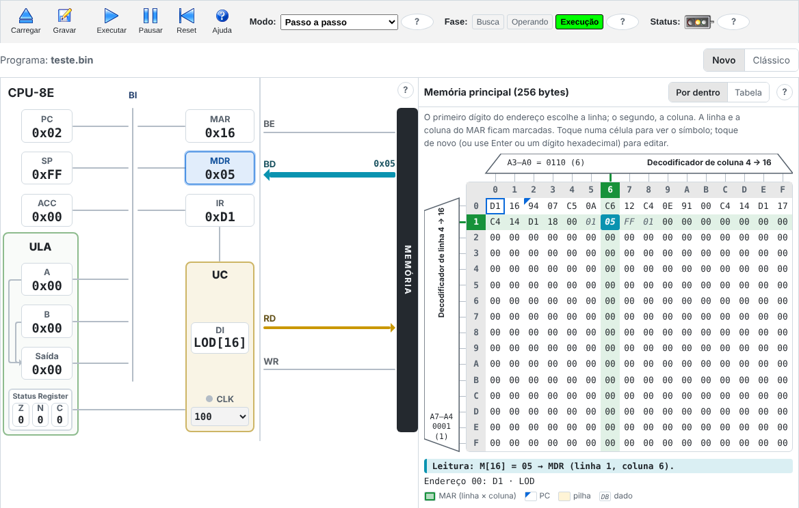

# CPU-8E Web

Simulador educacional de uma CPU de 8 bits, no navegador, em português e inglês.

O **CPU-8E Web** é uma versão para a web do simulador
[CPU-8E](https://github.com/wanderlan/cpu-8e), criado no IESB – Instituto de
Educação Superior de Brasília pelo [Prof. Joel Guilherme da Silva Filho](http://lattes.cnpq.br/7746085908957322) e
colaboradores para o ensino de arquitetura de computadores. O painel mostra
os registradores, a ULA, os barramentos e a memória de 256 bytes enquanto um
programa é executado pulso a pulso.

É um projeto irmão do [MEM-8E Web](https://github.com/tropical-yetti/mem-8e-web),
que abre a memória e mostra o que acontece dentro dela.

**Use no navegador:** <https://tropical-yetti.github.io/cpu-8e-web/>



## O que dá para fazer

- **Carregar um programa** do seu aparelho ou um dos que acompanham o simulador original, e **gravá-lo** de volta.
- **Executar pulso a pulso, instrução por instrução ou direto**, vendo os registradores e os barramentos acenderem a cada pulso de clock.
- **Ver o ciclo de instrução** nas lâmpadas de fase (busca, operando, execução) e o valor de cada registrador em binário.
- **Editar a memória** pela tabela, com o mouse ou o teclado, e ver o disassembly, os dados e a pilha.
- **Ajustar a velocidade** do clock, do passo lento à execução sem espera.

A [documentação](https://tropical-yetti.github.io/cpu-8e-web/#/documentacao),
dentro do site, explica a CPU, o ciclo de instrução e cada instrução, com
exemplos que carregam no simulador. Veja também o
[plano do projeto](docs/PLANO.md) e as [decisões de arquitetura](docs/adr/).

A série 1.x reproduziu o simulador original com fidelidade total (1.0) e
corrigiu os defeitos dele (1.1); as diferenças estão na página
[Diferenças do original](https://tropical-yetti.github.io/cpu-8e-web/#/documentacao/diferencas).
A série 2.x traz recursos próprios.

## Acessibilidade

O site é feito para funcionar só com o teclado e com leitor de tela, e segue
as diretrizes WCAG 2.2, nível AA. Uma tabela, só para leitores de tela, traz o
estado de todos os registradores, e a cada parada o leitor anuncia o que mudou
no último pulso de clock.

Os testes de acessibilidade são automáticos e rodam em todo pull request: o
[axe](https://github.com/dequelabs/axe-core), nos temas claro e escuro, e um
teste de uso só com o teclado. Ninguém que usa leitor de tela no dia a dia
testou o site ainda. Se você usa, conte como foi na
[issue #12](https://github.com/tropical-yetti/cpu-8e-web/issues/12).

## Desenvolvimento

Requer Node.js 22.

```sh
npm install
npm run dev        # servidor local
npm test           # testes
npm run build      # versão de produção em dist/
```

Veja [CONTRIBUTING.md](CONTRIBUTING.md) para as regras do projeto.

## Licença

Copyright 2009/10 [Joel Guilherme da Silva Filho](http://lattes.cnpq.br/7746085908957322) e colaboradores (CPU-8E).
Copyright 2026 colaboradores do CPU-8E Web.

[GPL-3.0-or-later](LICENSE), **sem nenhuma garantia**. Autoria e créditos em
[NOTICE.md](NOTICE.md); modificações em [CHANGELOG.md](CHANGELOG.md).
