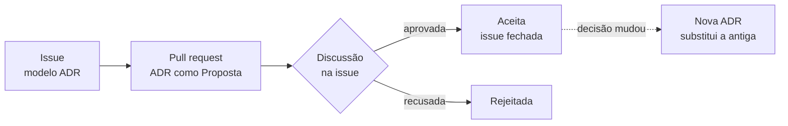

# 0001 — Registros de decisão de arquitetura, com diagramas em Mermaid

- **Data:** 2026-10-23
- **Proponente:** Ansone (redação com o Claude)
- **Estado:** Aceita (2026-10-23)
- **Discussão:** [#5](https://github.com/tropical-yetti/cpu-8e-web/issues/5)

## Contexto e motivação

Até a 1.1, as decisões do projeto ficaram num plano fora do repositório e nas
conversas de desenvolvimento. Isso bastava enquanto a regra era uma só:
reproduzir o simulador original e, depois, corrigir os defeitos dele.

A partir da 2.0, o CPU-8E Web passa a ter recursos próprios (montador, painel
novo, memória por dentro, guia, experimentos). Cada decisão de arquitetura
precisa ficar registrada junto com o código: o que foi decidido, por quê, o que
se descartou e o que muda. Sem isso, quem chegar depois (ou nós mesmos, daqui
a alguns meses) não sabe por que as coisas são como são.

## Alternativas consideradas

Para o registro:

1. **Continuar no plano:** simples, mas mistura decisões com tarefas e não
   guarda as alternativas descartadas.
2. **Wiki ou Discussions do GitHub:** fora do código, sem revisão por pull
   request e sem histórico junto dos arquivos que a decisão afeta.
3. **ADRs em Markdown no repositório, discutidas numa issue** (escolhida).

Para os diagramas:

1. **Imagens** (PNG ou SVG exportado): o histórico não mostra o que mudou.
2. **Ferramentas de desenho** (draw.io): arquivo e ferramenta à parte.
3. **Mermaid dentro do próprio Markdown** (escolhida): o GitHub desenha o
   diagrama na página, e cada mudança aparece como diferença de texto.

## Decisão

Cada decisão de arquitetura vira um arquivo em `docs/adr/`, numerado
(`0001-titulo.md`), escrito a partir de [`modelo.md`](modelo.md), com índice
em [`README.md`](README.md). A ADR traz:

- data, proponente, estado (Proposta, Aceita, Rejeitada ou Substituída por
  NNNN) e o link da issue de discussão;
- contexto e motivação, alternativas consideradas, a decisão (com diagrama em
  Mermaid quando ajudar) e os impactos.

Cada decisão nasce numa issue com o modelo **Decisão de arquitetura (ADR)** e
a etiqueta `adr`. A ADR entra num pull request como **Proposta** e passa a
**Aceita** quando a issue é aprovada e fechada. Uma ADR aceita não é editada:
se a decisão mudar, uma nova ADR a substitui.

Enquanto o projeto tiver um só mantenedor, a aprovação dele basta, e o
comentário de aprovação na issue registra a decisão em detalhe. A regra muda
quando houver mais desenvolvedores.

## Impactos

- **No repositório:** `docs/adr/` (modelo, índice e as ADRs) e o modelo de
  issue `.github/ISSUE_TEMPLATE/adr.yml`, que qualquer pessoa pode usar para
  propor uma decisão.
- **No processo:** o CONTRIBUTING passa a apontar para `docs/adr/README.md`.
  O plano do projeto cita as ADRs em vez de repetir as decisões.
- **No usuário:** nada muda no site.
- **Risco:** decisões pequenas virarem ADR à toa. Só entra o que muda a
  arquitetura, o processo ou o que o aluno vê de forma importante; o resto fica
  na issue e no pull request.
