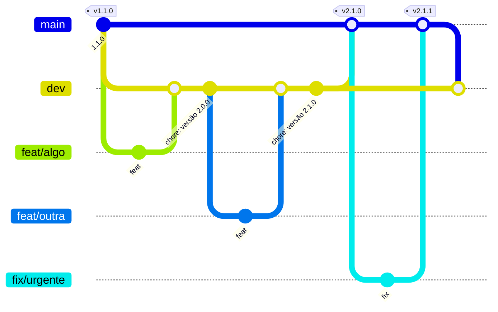

# 0002 — Séries 1.x e 2.x, ramos e regra de lançamentos

- **Data:** 2026-10-23
- **Proponente:** Ansone (redação com o Claude)
- **Estado:** Proposta
- **Discussão:** [#6](https://github.com/tropical-yetti/cpu-8e-web/issues/6)

## Contexto e motivação

A série 1.x reproduziu o simulador CPU-8E v2.2.3 (1.0) e corrigiu os defeitos
dele (1.1). O que vem agora diverge do original, e o número da versão precisa
deixar isso claro para quem usa o site.

Até a 1.1, cada pull request ia direto para a `main`, que é o que o GitHub
Pages publica: o site mudava a cada integração. O objetivo é fazer poucos pull
requests na `main` e publicar conjuntos de mudanças já testados juntos.

## Alternativas consideradas

1. **Seguir com 1.2, 1.3…:** esconde que o projeto deixou de ser uma
   reprodução do original.
2. **Manter o fluxo da 1.x**, com tudo indo para a `main`: simples, mas o site
   muda a cada pull request, e uma mudança pela metade chega ao aluno.
3. **Série 2.x para os recursos próprios, com o ramo `dev` e uma regra de
   lançamentos** (escolhida).

## Decisão

**Séries.** A 1.x é o original reproduzido e corrigido e termina na 1.1.0
(tag `v1.1.0`). A 2.x é o CPU-8E Web com recursos próprios. As versões seguem o
[versionamento semântico](https://semver.org/lang/pt-BR/).

**Ramos.**

- `main` é o que está publicado no site e só recebe **lançamentos**.
- `dev` recebe o trabalho em andamento e é o ramo padrão do repositório.
- Cada funcionalidade ou correção tem o próprio ramo, criado a partir de
  `dev` (`feat/…`, `fix/…`, `docs/…`, `test/…`, `ci/…`, `chore/…`), e volta
  para `dev` por pull request. O ramo é apagado depois da integração.

**Versões e lançamentos.**

- **Versões menores** (2.0.0, 2.1.0…) ficam na `dev`: cada uma ganha a sua
  seção no CHANGELOG e o número no `package.json`, num pull request
  `chore: versão X.Y.Z` para a `dev`.
- **Lançamento:** quando um conjunto de versões menores está estável e
  testado, um único pull request `dev` → `main` publica tudo de uma vez, com
  merge commit. O lançamento ganha uma tag (`v2.1.0`) e uma release no GitHub.
- **Correção urgente** (um erro no site publicado): o ramo `fix/…` sai da
  `main`, vira uma versão de correção (2.1.1) e entra direto na `main`. Em
  seguida, a `main` é integrada na `dev`, para a correção não se perder no
  próximo lançamento.

Os commits seguem [Conventional Commits](https://www.conventionalcommits.org/pt-br/)
e citam a issue quando houver uma: `feat: memória por dentro (#12)`.

## Impactos

- **No usuário:** o site só muda nos lançamentos, com conjuntos de versões já
  testados. Uma correção urgente chega mais rápido, sem esperar o próximo
  lançamento.
- **No CI:** roda em todo pull request e a cada push na `main` e na `dev`. A
  publicação no GitHub Pages continua só a partir da `main`.
- **No processo:** o CONTRIBUTING descreve o passo a passo. A tag e a release
  são criadas pelo mantenedor no GitHub.
- **Risco:** a `dev` acumular mudanças demais sem lançamento. Um lançamento
  intermediário pode sair depois de qualquer versão estável.
