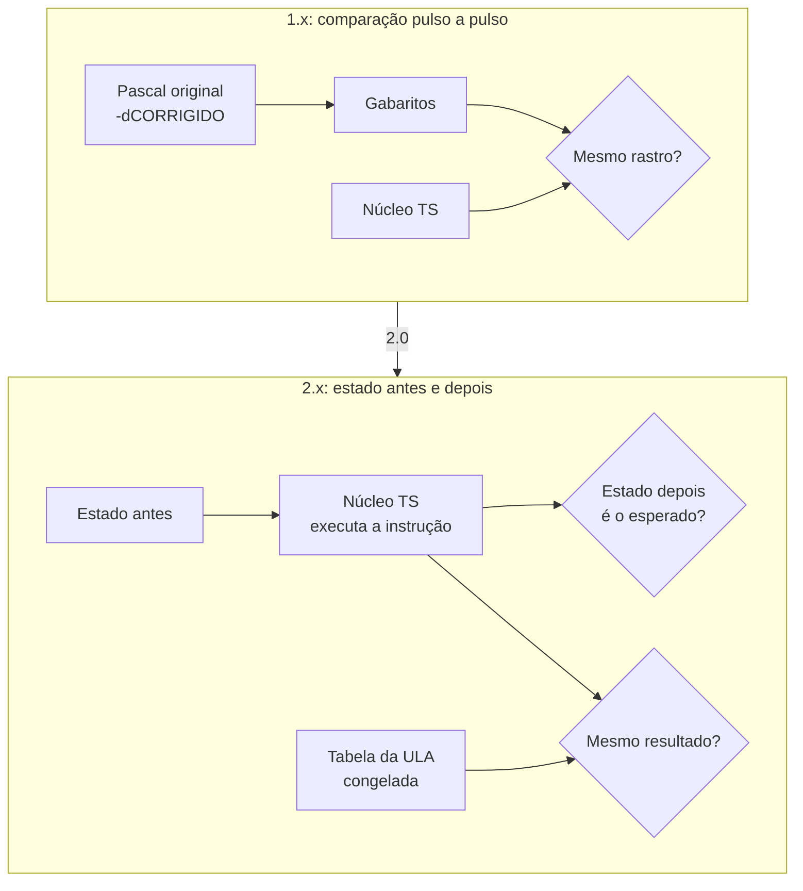

# 0003 — Validação por instrução e estado, no lugar da comparação pulso a pulso

- **Data:** 2026-10-23
- **Proponente:** Ansone (redação com o Claude)
- **Estado:** Aceita (2026-10-23)
- **Discussão:** [#7](https://github.com/tropical-yetti/cpu-8e-web/issues/7)

## Contexto e motivação

Até a 1.1, o núcleo foi conferido pulso a pulso contra o código Pascal do
simulador original. O `tools/referencia/cpu8e_ref.pas` executa um programa e
grava cada evento; os gabaritos e um teste com 60 programas aleatórios
comparam esse rastro com o do núcleo em TypeScript. Para a 1.1, cada correção
também foi feita no Pascal, num bloco `{$IFDEF CORRIGIDO}`, e o CI instala o
Free Pascal.

Isso fazia sentido enquanto o objetivo era ser fiel ao original. Na 2.0, o
comportamento passa a ser do próprio CPU-8E Web. Manter uma segunda
implementação em Pascal para cada mudança dobra o trabalho e não prova mais
nada sobre o original.

## Alternativas consideradas

1. **Manter a referência em Pascal** e levar cada mudança para ela: dobra o
   trabalho, exige o Free Pascal no CI e mantém uma linguagem a mais no projeto.
2. **Congelar os gabaritos da 1.1** como teste de regressão, sem o Pascal:
   qualquer mudança intencional na sequência de pulsos quebraria os testes, e
   não haveria referência para gerar gabaritos novos.
3. **Testes por instrução e por estado** (escolhida): conferem o que cada
   instrução faz, e não a ordem exata dos pulsos.

## Decisão

- **Testes por instrução:** para cada um dos 35 códigos (23 instruções), um
  teste prepara a CPU e a memória, executa a instrução e confere o estado
  depois: memória, registradores, flags, PC e SP.
- **Casos de borda:** carry na soma, empréstimo na subtração, resultado zero e
  negativo, deslocamentos com contador `00` e maior que 8, desvios tomados e
  não tomados, a pilha que alcança o programa e código inválido.
- **Programa "todas as instruções":** um programa novo passa por todas as
  instruções e pelos casos de estouro e grava os resultados na memória; um
  teste confere o estado no fim. Ele também vira exemplo comentado para os
  alunos. O `allopcodes.bin` fica como está, por ser do original.
- **Tabela da ULA:** a tabela completa (todas as operações × A × B), já gravada
  em `tests/fixtures/`, continua como teste de regressão. Ela confere
  resultados, não pulsos, e não precisa do Pascal.
- **O que sai:** `tools/referencia/`, os gabaritos, o teste com programas
  aleatórios e a instalação do Free Pascal no CI. Tudo continua no histórico do
  repositório e na tag `v1.1.0`, a última versão conferida contra o original.

## Impactos

- **No código:** saem `tools/referencia/`, `tests/fixtures/gabaritos/`,
  `tests/core/fidelidade.test.ts`, `tests/core/aleatorios.test.ts` e
  `tests/core/rastro.ts`; entram testes por instrução e o programa novo.
- **No CI:** sai a instalação do Free Pascal.
- **Nos testes:** a meta de cobertura do núcleo (95% das linhas e 90% dos
  desvios) continua valendo.
- **No usuário:** nada muda no site.
- **Risco:** uma mudança na ordem dos pulsos de uma instrução passa sem
  aviso se o estado final não mudar. Onde a ordem importa para o aluno (por
  exemplo, a animação de uma instrução), o teste confere também a sequência de
  pulsos daquela instrução.
