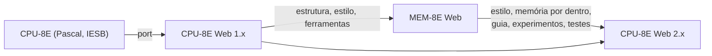

# 0004 — Código e estilo comuns com o MEM-8E Web

- **Data:** 2026-10-23
- **Proponente:** Ansone (redação com o Claude)
- **Estado:** Proposta
- **Discussão:** [#8](https://github.com/tropical-yetti/cpu-8e-web/issues/8)

## Contexto e motivação

O CPU-8E Web tem um projeto irmão, o
[MEM-8E Web](https://github.com/tropical-yetti/mem-8e-web), que abre a
"caixa-preta" da memória e mostra o que acontece dentro dela numa leitura ou
escrita. O aluno deve sentir que usa a mesma interface nos dois: mesmo visual,
mesmos padrões de ajuda e de documentação, e recursos parecidos (memória por
dentro, guia de primeiro acesso, experimentos "e se…?", roteiro de aula).

O MEM-8E Web nasceu copiando a estrutura e o estilo do CPU-8E Web. Desde
então, ganhou recursos e cuidados que o CPU-8E Web ainda não tem. Agora o
caminho é o inverso: muito do que ele fez serve aqui.

## Alternativas consideradas

1. **Cada projeto com o próprio visual e código:** os dois se afastam com o
   tempo, e o aluno sente que são programas diferentes.
2. **Um pacote compartilhado** pelos dois projetos: evita a duplicação, mas
   exige publicar e versionar um pacote enquanto os dois ainda mudam muito.
3. **Copiar e adaptar, registrando a origem** (escolhida). É a mesma escolha
   que o MEM-8E Web fez no sentido contrário.

## Decisão

Copiar e adaptar do MEM-8E Web o que servir ao CPU-8E Web:

- o estilo e as cores, inclusive as dos fios por tipo de barramento;
- os componentes da vista "memória por dentro" (decodificadores de linha e de
  coluna, grade 16 × 16);
- o balão do guia de primeiro acesso e dos experimentos, a ajuda "?" e a
  legenda das siglas;
- os testes comuns (traduções, leitor de tela simulado, ajudantes dos testes de
  ponta a ponta) e as configurações de CI.

Cada arquivo copiado registra a origem no cabeçalho. A ideia de integrar os
dois simuladores (clicar no bloco Memória e abrir o MEM-8E Web na transação
corrente) fica para depois.

## Impactos

- **Licença:** os dois projetos são GPL-3.0-or-later. Um arquivo copiado que
  deriva de um arquivo do CPU-8E original leva no cabeçalho a origem e o aviso
  de copyright original, e entra na lista `DERIVADOS` de
  `tests/licenca.test.ts`. O NOTICE.md cita o MEM-8E Web como origem do que
  for copiado de lá.
- **No usuário:** os dois simuladores ficam com a mesma cara e os mesmos
  padrões de uso.
- **Manutenção:** uma correção no estilo, nas ferramentas ou nas regras de um
  projeto precisa ser levada ao outro manualmente.
- **Futuro:** se a duplicação crescer demais, a alternativa 2 pode ser revista
  numa nova ADR.
