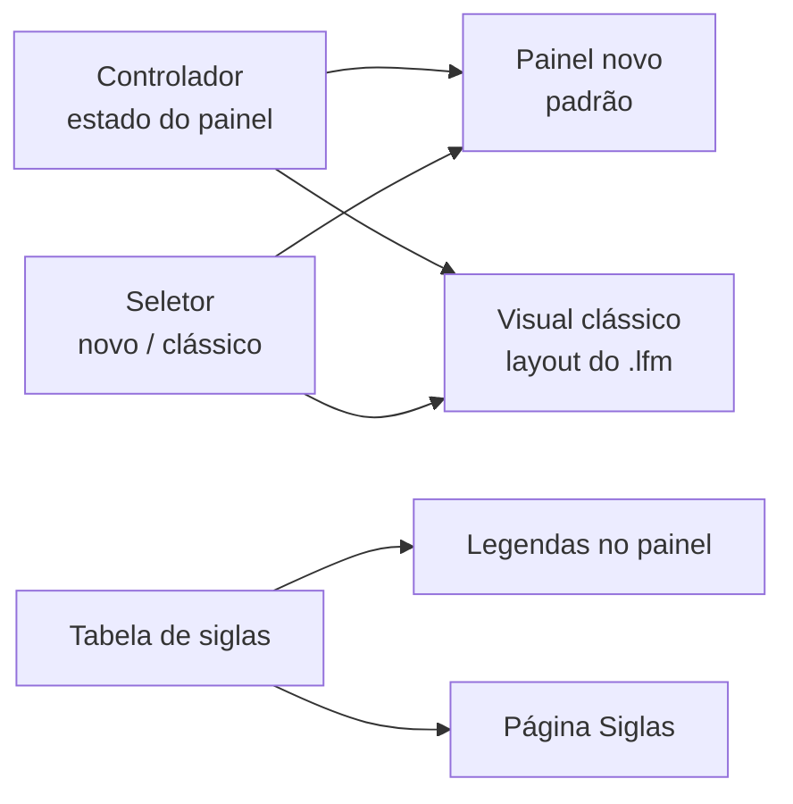

# 0005 — Painel novo como padrão e o desenho original como visual clássico

- **Data:** 2026-10-23
- **Proponente:** Ansone (redação com o Claude)
- **Estado:** Proposta
- **Discussão:** [#16](https://github.com/tropical-yetti/cpu-8e-web/issues/16)

## Contexto e motivação

O painel do CPU-8E Web reproduz o formulário do simulador original: as
posições, as cores e as dicas saem do `CPU8E_Panel.lfm` do Lazarus. Isso foi
certo na série 1.x, que buscava fidelidade, mas o desenho tem limites:

- cores fixas, que não combinam com o tema escuro;
- rótulos pequenos;
- um diagrama que precisa rolar ou encolher no celular;
- um visual diferente do MEM-8E Web, o projeto irmão.

Na 2.0, os dois simuladores devem parecer a mesma interface
([ADR 0004](0004-codigo-e-estilo-comuns.md)). Ao mesmo tempo, o desenho
original tem valor: é o que os alunos do CPU-8E conhecem.

## Alternativas consideradas

1. **Manter o desenho original e só ajustar as cores:** pouco trabalho, mas o
   painel continua diferente do MEM-8E Web e preso às posições do formulário.
2. **Trocar o desenho de vez:** o painel fica igual ao do MEM-8E Web, mas
   quem conhece o CPU-8E perde a referência.
3. **Painel novo como padrão, com o desenho original como opção "visual
   clássico".**

## Decisão

Alternativa 3. O painel novo segue o estilo do MEM-8E Web e é o padrão; o
desenho original continua disponível, sem mudanças, num seletor.

- Registradores em caixas, fios coloridos por tipo de barramento (interno,
  endereço, dados, controle) e siglas com legenda ao apontar ou focar.
- A cada pulso de clock, acendem os registradores e os trechos de fio
  envolvidos, como hoje.
- Um seletor **Visual: novo | clássico** troca o desenho; a escolha fica
  guardada no navegador.
- Os dois visuais leem o mesmo estado do controlador e têm os mesmos controles
  acessíveis: os registradores continuam botões com o valor em hexadecimal e
  em binário, e o seletor de clock não muda.
- A página "Siglas" da documentação sai da mesma tabela das legendas.
- O `CPU8E_Panel.lfm` e o extrator do layout continuam como estão.

## Impactos

- **No código:** um componente novo para o painel e os fios, a tabela de
  siglas em `src/painel/` e o seletor de visual. O `DiagramaCpu.vue` atual
  passa a ser o visual clássico.
- **Nos testes:** os testes de ponta a ponta rodam nos dois visuais; o axe,
  nos dois temas; um teste confere que toda sigla do painel tem legenda e
  aparece na página "Siglas".
- **No usuário:** um painel com a cara do MEM-8E Web, legível no celular e no
  tema escuro, e o desenho de sempre a um clique.
- **Riscos:** dois visuais para manter. Por isso os dois dependem só do estado
  do controlador, e nenhuma regra de funcionamento fica dentro de um visual.
