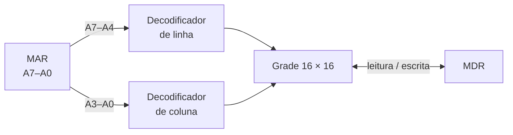

# 0006 — Memória por dentro (linha × coluna) como vista padrão

- **Data:** 2026-10-23
- **Proponente:** Ansone (redação com o Claude)
- **Estado:** Proposta
- **Discussão:** [#17](https://github.com/tropical-yetti/cpu-8e-web/issues/17)

## Contexto e motivação

A memória aparece hoje como uma tabela de 256 linhas: endereço, conteúdo e
símbolo. Ela mostra o que está guardado, mas não como o endereço no MAR
escolhe uma posição. O MEM-8E Web mostra exatamente isso, na vista "Memória
por dentro (linha × coluna)": os 4 bits altos do endereço escolhem a linha, os
4 baixos escolhem a coluna, numa grade de 16 × 16.

Trazer essa vista liga os dois simuladores: o aluno vê a CPU executando o
programa e, ao mesmo tempo, a memória sendo acessada por dentro.

## Alternativas consideradas

Sobre a vista:

1. **Manter só a tabela:** nada muda, e a memória continua uma lista.
2. **Vista por dentro só como opção, com a tabela como padrão:** quem não
   procurar não encontra.
3. **Vista por dentro como padrão, com a tabela como alternativa.**

Sobre o que acende na grade:

1. **Só nos pulsos que leem ou gravam a memória,** como no hardware: a grade
   fica apagada quase o tempo todo.
2. **Acompanhar o MAR o tempo todo:** a linha e a coluna do endereço no MAR
   ficam sempre marcadas, e os pulsos de leitura e escrita mostram o acesso.

## Decisão

Vista por dentro como padrão (alternativa 3), acompanhando o MAR o tempo todo
(alternativa 2).

- A memória ganha um seletor **Por dentro | Tabela**. **Por dentro** mostra o
  decodificador de linha (A7–A4), o de coluna (A3–A0) e a grade 16 × 16.
  **Tabela** é a vista de hoje, com a coluna Símbolo.
- A linha e a coluna do MAR ficam marcadas o tempo todo. Num pulso de leitura
  (M[MAR] → MDR) ou de escrita (MDR → M[MAR]), a célula acessada e o sentido
  do dado acendem.
- A grade também mostra o que a tabela mostra: a posição do PC, a região da
  pilha e os bytes que são dados.
- A célula escolhida mostra o endereço, o valor e o símbolo (o disassembly
  daquele byte).
- As células são editáveis como no MEM-8E Web (dois cliques, Enter ou um
  dígito hexadecimal), com a mesma validação de 00 a FF da tabela.
- Leitor de tela: a grade é anunciada uma célula por vez ("linha 3, coluna A:
  05"), nunca as 256 em sequência; os decodificadores ficam ocultos e um
  resumo diz a linha e a coluna escolhidas.
- Não há Z nem X: na CPU-8E todo byte é definido. Os decodificadores estão
  sempre habilitados, porque não há sinal de seleção do chip.
- A escolha da vista fica guardada no navegador.

## Impactos

- **No código:** componentes novos para a grade e os decodificadores, copiados
  e adaptados do MEM-8E Web com o cabeçalho de origem
  ([ADR 0004](0004-codigo-e-estilo-comuns.md)); o `TabelaMemoria.vue` passa a
  ser a vista alternativa.
- **Nos testes:** a linha e a coluna seguem o MAR; leitura e escrita acendem a
  célula certa; editar uma célula muda só aquele byte; o leitor de tela
  simulado anuncia uma célula por vez.
- **No usuário:** a memória deixa de ser uma lista e passa a mostrar como o
  endereço é decodificado, com a tabela a um clique.
- **Riscos:** a grade ocupa mais espaço no celular. Ela precisa caber em
  320 px sem rolagem horizontal, como no MEM-8E Web.
