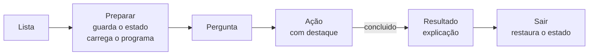

# 0007 — Experimentos "e se…?" guiados

- **Data:** 2026-10-25
- **Proponente:** Ansone (redação com o Claude)
- **Estado:** Proposta
- **Discussão:** [#27](https://github.com/tropical-yetti/cpu-8e-web/issues/27)

## Contexto e motivação

Muito do que se aprende sobre uma CPU vem do que dá errado: uma soma que
estoura, uma comparação que dá o resultado "errado" porque o número tinha
sinal, uma pilha que desce até o programa, um byte de dado executado como
instrução. O simulador já mostra tudo isso, mas só para quem sabe escrever o
programa que monta a situação, byte a byte, na memória.

A 2.1 traz experimentos prontos: o simulador carrega um programa curto,
pergunta o que o aluno espera, conduz a execução e explica o resultado. São
sete:

| Experimento                  | O que se vê                                                                                                             |
| ---------------------------- | ----------------------------------------------------------------------------------------------------------------------- |
| Estouro na soma              | `7F + 01` dá `80`: N acende, e o número "positivo" vira negativo; `FF + 01` dá `00`, com Z e C                          |
| Comparação com e sem sinal   | `CMP` de `FE` com `02`: `JGT` (pelo N) diz que é menor, `JCY` (pelo C) diz que é maior ou igual; os dois estão "certos" |
| Pilha que alcança o programa | uma sub-rotina que chama a si mesma: a pilha desce até o código e o simulador avisa                                     |
| Código inválido              | um desvio para um byte que não é instrução: a CPU para com a mensagem de código inválido                                |
| Laço sem fim                 | um `JMP` para ele mesmo, em execução contínua: só Pausar ou Reset tiram a CPU dali                                      |
| Programa que se modifica     | um `STO` grava em cima do operando de uma instrução que ainda vai ser executada                                         |
| Salto para o meio dos dados  | um desvio para o segundo byte de uma instrução: o operando é executado como código                                      |

## Alternativas consideradas

1. **Exemplos na documentação, com o botão "Carregar no simulador":** já
   existe para os programas de exemplo. Não pergunta nada, não conduz e não
   explica o resultado na tela.
2. **Vídeos ou animações gravadas:** não interativos e difíceis de manter nos
   dois idiomas.
3. **Experimentos dentro do simulador, descritos como dados** (proposta),
   como no MEM-8E Web: reaproveitam o balão e o destaque do guia e podem ser
   testados.

## Decisão

Alternativa 3.

### 1. Experimentos como dados

Cada experimento é um objeto em `src/experimentos/`, com a situação inicial e
os passos:

```ts
interface Experimento {
  id: string
  /** O programa (bytes a partir de 00) e, se preciso, o modo e o clock. */
  situacao: { programa: number[]; modo?: Modo; clock?: number }
  passos: {
    /** O que destacar na tela (o mesmo `data-guia` do guia). */
    alvo?: string
    /** O passo termina sozinho quando isto fica verdadeiro. */
    concluido?(simulador: SimuladorStore): boolean
  }[]
  /** Parte da tela em destaque no resultado. */
  alvoResultado?: string
}
```

Os textos (pergunta, passos e explicação) ficam nos arquivos de idioma, em
`experimentos.<id>`. Cada experimento tem três momentos: **pergunta** ("o que
você acha que vai acontecer?"), **ação** (com a parte da tela em destaque) e
**resultado** (a explicação aparece quando `concluido` detecta a situação: uma
flag, o PC num endereço, a mensagem da pilha ou do código inválido).

- Um botão **Experimentos**, ao lado de "Ver o guia", abre a lista, e o guia
  ganha um passo que aponta para ele.
- Só um experimento (ou o guia) fica ativo por vez.
- O balão é o `BalaoBase` do guia, sem escurecer a tela: o aluno precisa ver o
  painel e a memória mudarem.
- O programa de cada experimento aparece na memória com o nome
  "Experimento: …" e o disassembly de sempre. Na 2.2, com o montador, eles
  ganham também o assembly comentado.

### 2. Entrar e sair sem perder nada

Antes de preparar, o simulador guarda o estado: a memória, os registradores,
as flags, o programa carregado, o modo e o clock. Uma execução em andamento é
interrompida, como num Reset. **Sair do experimento** devolve tudo como
estava. Para isso, o controlador ganha `fotografar()` e `restaurar()`; a CPU
não muda.



## Impactos

- **No código:** `src/experimentos/` (novo, a partir do MEM-8E Web, com o
  cabeçalho de origem); `src/simulador/controlador.ts` e a store
  (`fotografar`, `restaurar` e preparar sem a mensagem "Foram lidos…");
  `src/guia/` (um passo a mais e o balão comum).
- **Nos testes:** cada experimento tem um teste que prepara, executa e confere
  o resultado esperado (as flags, o PC, a mensagem); sair restaura o estado
  exato; ponta a ponta, axe e leitor de tela simulado na lista e no balão.
- **No usuário:** o botão Experimentos e um passo a mais no guia.
- **Riscos:** o balão comum pode complicar o guia; os testes do guia ficam
  como estão para garantir que ele não muda. A pilha e o código inválido já
  pausam com mensagem (v1.1); o experimento só usa o que já existe.
