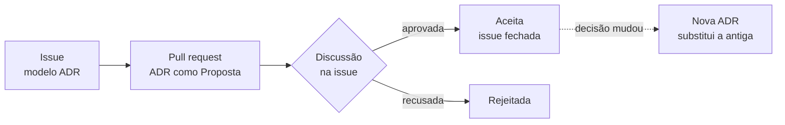

# Registros de decisões de arquitetura (ADRs)

Cada decisão de arquitetura do CPU-8E Web, a partir da versão 2.0, fica
registrada aqui, num arquivo Markdown numerado. Os diagramas são escritos em
Mermaid e versionados junto com o texto.

## Como propor uma decisão

1. Abra uma issue com o modelo **Decisão de arquitetura (ADR)**.
2. Escreva a ADR num ramo, a partir de [`modelo.md`](modelo.md), com o
   próximo número livre e o estado **Proposta**.
3. A discussão acontece na issue. Quando a decisão for aprovada, o estado passa
   a **Aceita** e o pull request é integrado.

Por enquanto, a aprovação do mantenedor basta. Isso muda quando o projeto
tiver mais desenvolvedores.

Uma ADR aceita não é editada depois. Se a decisão mudar, uma nova ADR a
**substitui**, e a antiga passa ao estado "Substituída por NNNN".

## Índice

| Nº                                            | Decisão                                                                | Estado   |
| --------------------------------------------- | ---------------------------------------------------------------------- | -------- |
| [0001](0001-registros-de-decisao.md)          | Registros de decisão de arquitetura, com diagramas em Mermaid          | Aceita   |
| [0002](0002-versoes-e-lancamentos.md)         | Séries 1.x e 2.x, ramos e regra de lançamentos                         | Aceita   |
| [0003](0003-validacao-por-instrucao.md)       | Validação por instrução e estado, no lugar da comparação pulso a pulso | Aceita   |
| [0004](0004-codigo-e-estilo-comuns.md)        | Código e estilo comuns com o MEM-8E Web                                | Aceita   |
| [0005](0005-painel-novo-e-visual-classico.md) | Painel novo como padrão e o desenho original como visual clássico      | Proposta |
| [0006](0006-memoria-por-dentro.md)            | Memória por dentro (linha × coluna) como vista padrão                  | Proposta |
